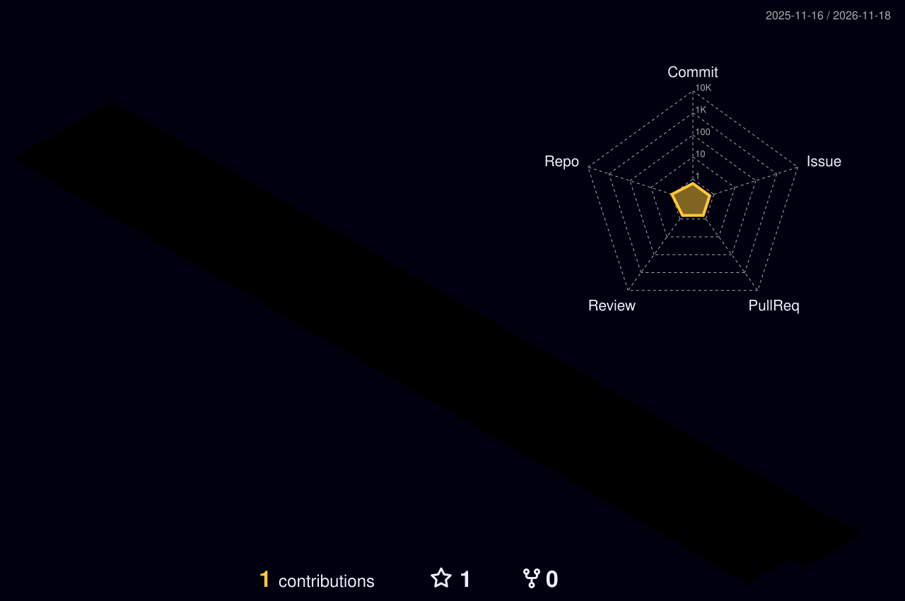

<!-- Generated by DevVerse (https://github.com/Muhtasim-Masum-Hasnayen/devverse-profile) -- do not edit this file, edit config.yml -->

 

 

Like this profile? ⭐ <b>star the template</b> and 👤 <b>follow <a href="https://github.com/Muhtasim-Masum-Hasnayen">@Muhtasim-Masum-Hasnayen</a></b> to support the creator.

